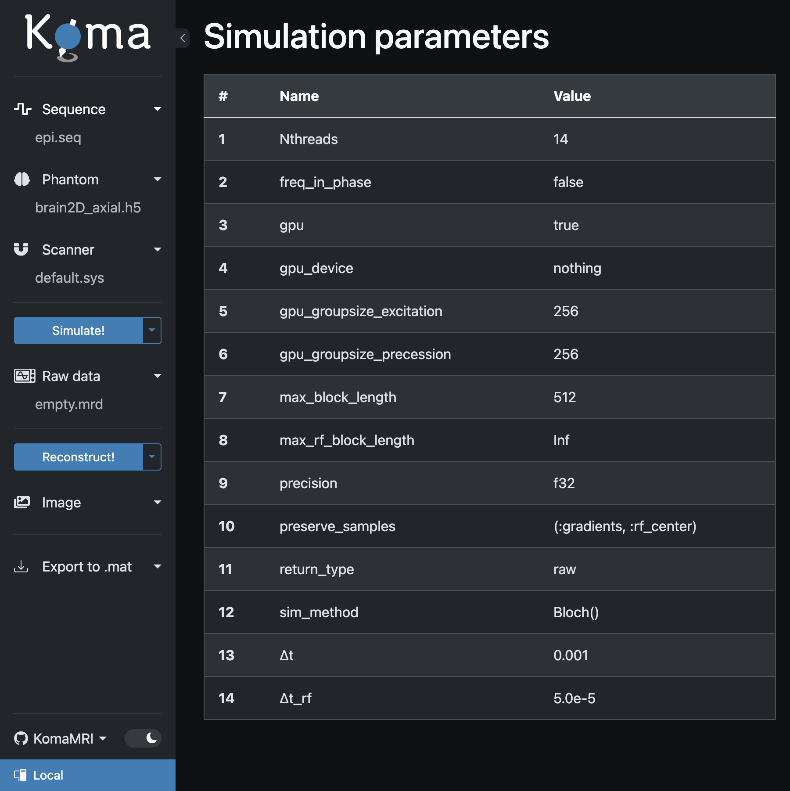
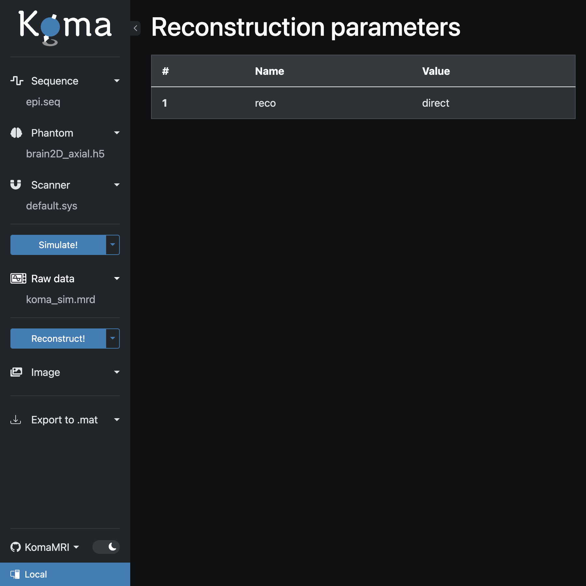

# Use Koma's User Interface

This section provides a comprehensive guide on using the **User Interface** of the **KomaMRI** package and delves into the internal processes that occur during interaction. By the end of this section, you will be equipped to execute a complete workflow even without any prior programming experience.

```@raw html
<p align="center"></p>
```


## Basic Workflow
(You can also go to [analog steps using Scripts](1-3-use-koma-scripts.md#Basic-Workflow))

As a general overview, remember the following workflow steps when using KomaMRI:

* Loading Simulation Inputs: **Scanner**, **Phantom**, **Sequence**
* Running Simulation
* Reconstructing Image using **MRIReco**

In the following subsections, we will cover all the mentioned steps. First, open the **Julia REPL** and enter the following commands to include the **KomaMRI** package and launch the user interface:
```julia-repl
julia> using KomaMRI

julia> KomaUI()
```
Dark mode is the default. Use the switch at the bottom of the sidebar to
switch themes, or start with `KomaUI(darkmode=false)` for light mode.
After installing the [`koma` app](1-4-use-koma-cli.md#Installing-the-App) (Julia 1.12+), the same interface can be opened from the terminal:
```bash
koma
```
Use the arrow to the right of the sidebar to collapse or expand it. Manual collapse stays collapsed; expanding restores width-responsive behavior.
```@raw html
<p align="center"></p>
```

## Loading Simulation Inputs
(You can also go to [analog steps using Scripts](1-3-use-koma-scripts.md#Loading-Simulation-Inputs))

The user interface has preloaded certain inputs into RAM, including the **Scanner**, **Phantom**, and **Sequence** structs. In the following subsections, we will demonstrate how to visualize these inputs.

### Scanner

Use the Scanner file picker to load a `.sys` file; the reload button reads it again.
See the [scanner file reference](../reference/4-koma-files.md#Scanner) for creating files and supported models.

Select `View limits` for hardware limits or `View coil sensitivities` for receive maps.
`View gradients` and `View B₁ maps` are not yet available and are disabled.
```@raw html
<p align="center"></p>
```

### Phantom

To see the phantom already stored in RAM, simply click on the `Phantom` dropdown an then press the `View phantom` button. The preloaded phantom is a slice of a brain:
```@raw html
<p align="center"></p>
```

For moving phantoms, select `|v|`, `vx`, `vy`, or `vz` to color spins in cm/s. Signed components
use blue/white/red for negative/zero/positive with fixed symmetric limits over time.
Magenta marks exit before a reset; cyan marks re-entry after it. Reset jumps are
excluded from the velocity scale.
Property buttons share one plot, preserving camera and time. Use ▶/❚❚ beside the
time slider for a five-second loop; playback skips display frames when needed,
but every time step remains selectable. Dragging the slider pauses playback.
Motion previews sample visible spins; zooming concentrates detail in that region.
The percentage reports visible spins shown; stopping restores spatial detail.

It is also possible to load `.h5` phantom files. The **KomaMRI.jl** has some examples stored at `~/.julia/packages/KomaMRI/<id-string>/examples/2.phantoms/`. For instance, let's load the `sphere_chemical_shift.h5` file:
```@raw html
<p align="center"></p>
```

Note that you can select different spin parameters to visualize like `ρ`, `T1`, `T2`, among others. 

### Sequence

Select `View definitions` to inspect the loaded sequence's `DEF` dictionary, including any `FOV`, `Nx`, `Ny`, and `Nz` values.

There are two options to visualize the sequence already preloaded in RAM: in the time domain or in the k-space. The preloaded sequence is a single-shot EPI.

For visualization of the sequence in the time domain, click on the `Sequence` dropdown and then press the `View sequence` button:
```@raw html
<p align="center"></p>
```

For visualization of the sequence in the k-space, click on the `Sequence` dropdown and then press the `View k-space` button:
```@raw html
<p align="center"></p>
```

You can also display the `Moments` related to the **Sequence** by pressing the `View moments` and then pressing the buttons for zero, first and second moments.

It is also possible to load **Pulseq** compatible `.seq` sequence files. Explicit `Nx`, `Ny`, `Nz`, and `FOV` definitions are recommended for reconstruction. If dimensions are missing, a warning reports the inferred matrix without modifying the file. The **KomaMRI** has some examples stored at `~/.julia/packages/KomaMRI/<id-string>/examples/1.sequences/`. For instance, let's load the `spiral.seq` file and view it the time domain and k-space:
```@raw html
<p align="center"></p>
```
```@raw html
<p align="center"></p>
```

And remember, you are free to interact with the plots:
```@raw html
<p align="center"></p>
```


## Running Simulation
(You can also go to [analog steps using Scripts](1-3-use-koma-scripts.md#Running-Simulation))

Once the inputs are loaded in RAM, it is possible to perform the simulation to get the **Raw Signal**.

### Simulation Parameters

To visualize the default simulation parameters, click on the `Simulate!` dropdown and then press the `View options` button:
```@raw html
<p align="center"></p>
```

### Visualization of the Raw Signal

Press the `Simulate!` button to perform the simulation (this may take a while). Automatically the generated **Raw Signal** should be displayed or you can click on the `Raw data` dropdown and then press the `View raw data` button:
```@raw html
<p align="center"></p>
```

## Reconstructing Image using MRIReco
(You can also go to [analog steps using Scripts](1-3-use-koma-scripts.md#Reconstructing-Image-using-MRIReco))

Once the **Raw Signal** is loaded in RAM, it is possible to reconstruct the image.

### Reconstruction Parameters

To visualize the default reconstruction parameters, click on the `Reconstruct!` dropdown and then press the `View options` button:
```@raw html
<p align="center"></p>
```

### Visualization of the Image

Press the `Reconstruct!` button to perform the reconstruction (this may take a while). Automatically the generated **Image** should be displayed or you can click on the `Image` dropdown and then press the `View image` button:
```@raw html
<p align="center"></p>
```

## Exporting results

(You can also go to [analog steps using Scripts](1-3-use-koma-scripts.md#Exporting-Results-to-.mat-File))

Open `Export results` to download the image (`.mat`) or raw data (`.mat` or `.mrd`).
Electron opens a folder picker. Supported browsers open a Save As picker;
other browsers download the file using their download settings.

```@raw html
<p align="center"></p>
```

See the [MATLAB export reference](../reference/4-koma-files.md#MATLAB-exports)
for filenames, struct fields, and MATLAB examples.

## Backend and device selection

Click the host badge at the bottom of the sidebar to choose the CPU or a GPU for
the next simulation. Hover to see the selected device.

GPU choices appear only when a functional backend is loaded (for example,
`using CUDA` or `using Metal` before `KomaUI()`). Otherwise, CPU is used.

```@raw html
<p align="center"></p>
```

## Browser-based KomaUI (easier for AI agents)

In a local Julia session:

```julia
using KomaMRI
# using CUDA  # Load before KomaUI for NVIDIA GPU simulation
KomaUI(; browser=true)
```

```@raw html
<p>KomaUI prints the URL, for example:</p>
<div class="language-text vp-adaptive-theme">
  <button title="Copy Code" class="copy"></button><span class="lang">text</span>
  <pre><code>┌ Info: Open KomaUI in your browser
└   url = "<span style="color:var(--vp-c-indigo-1)">http://localhost:9384/</span>"</code></pre>
</div>
<p>Open the printed URL in <span style="color:var(--vp-c-indigo-1)">your local browser</span>.</p>
```

### Running on a server

```@raw html
<p>Run the same code in a Julia session on the <span style="color:var(--vp-c-yellow-1)">server</span>.</p>
<p>Use the printed port (<code style="color:var(--vp-c-yellow-1)">9384</code> in this example) as the <span style="color:var(--vp-c-yellow-1)">server port</span> in the SSH command below.</p>
<p>Run this on <strong style="color:var(--vp-c-indigo-1)">your local computer</strong>, replacing <code style="color:var(--vp-c-yellow-1)">user@server</code> (or SSH alias) with your SSH username and <span style="color:var(--vp-c-yellow-1)">server address</span>:</p>
<div class="language-sh vp-adaptive-theme">
  <button title="Copy Code" class="copy"></button><span class="lang">sh</span>
  <pre><code>ssh -N -L <span style="color:var(--vp-c-indigo-1)">9384</span>:<span style="color:var(--vp-c-yellow-1)">127.0.0.1:9384 user@server</span></code></pre>
</div>
<p>Keep it running, then open <a href="http://localhost:9384" target="_blank" rel="noreferrer" style="color:var(--vp-c-indigo-1)">http://localhost:9384</a> in <span style="color:var(--vp-c-indigo-1)">your local browser</span>.</p>
```

### Multiple windows

Show independent windows together in one browser workspace:

```julia
w1 = KomaUI(; show_window=false, return_window=true)
w2 = KomaUI(; show_window=false, return_window=true)
workspace = KomaWorkspace([w1, w2])
```

Use **Add window** to create another tile, or `add_window!(workspace; sim=Dict("gpu" => false))`
from Julia. Each tile has its own inputs, outputs, device, and progress. Expand a
tile to focus it without reconnecting. Numbers appear only in workspace headers.
`KomaWorkspace([w])` can also adopt an existing browser window, preserving its data
and server port. For SSH, forward the workspace's single printed port.

## Controlling the UI from Julia (easier for AI agents)

Load inputs, simulate and reconstruct, then save outputs:

```julia
w = KomaUI(; return_window=true)

# Load inputs without a dialog
load_file!(w, :sequence, "example.seq")   # Or: w.seq[] = seq
load_file!(w, :phantom, "brain.phantom")  # Or: w.obj[] = obj
load_file!(w, :scanner, "scanner.sys")    # Or: w.sys[] = sys

# Simulate and reconstruct
w.sim_params[] = merge(w.sim_params[], Dict("precision" => "f32"))
w.rec_params[] = merge(w.rec_params[], Dict(
    :reco => "standard", :iterations => 10, :recon_policy => (COIL=:rss,)))
raw = simulate!(w)
image = reconstruct!(w)

# Save outputs without a dialog
result = export_results(w, :raw_data_mrd; path="/data/exports/raw.mrd")
export_results(w, :raw_data_mat; path="/data/exports/raw.mat")
export_results(w, :image_mat; path="/data/exports/image.mat")

# Other menu actions
click!(w, :view_kspace)
click!(w, :view_coil_sensitivities)
click!(w, :reload_sequence)

# Backend-related actions
get_devices()
click!(w, :select_device; gpu=false)                # CPU
click!(w, :select_device; gpu=true, id=device_id)   # An available GPU
```

Export paths refer to the machine running Julia; the parent directory must exist.
`result.path` is the saved file and `result.url` is its download URL in browser mode
(`nothing` in Electron). Retrieve remote downloads through the SSH tunnel.

For GPU simulation, import the backend first, e.g. `using Metal` or `using CUDA`.
See the [full action list](../reference/6-koma-mri.md#Actions) (or `?click!` in Julia)
and [window data reference](../reference/6-koma-mri.md#Window-data).

Use a GPU ID from `get_devices()`. Omit `id` to select the backend's current GPU.
An unavailable GPU throws and leaves
the settings unchanged.

### Long-running operations

Calls block until complete and throw on failure. To inspect progress during a
simulation, keep its task:

```julia
task = @async simulate!(w)
ui_status(w)                  # Simulation status, progress, elapsed_seconds, eta_seconds
raw = fetch(task)             # Waits and returns the result, or throws
```

Elapsed time and ETA are simulation-only; reconstruction reports `nothing` for both.
ETA is a block-based estimate and can fluctuate during setup or compilation.

While an operation runs, only theme/sidebar toggles remain available. Assign
observables directly only when idle. `fetch(task)` waits for the operation;
`wait(w)` waits for the UI to close.
