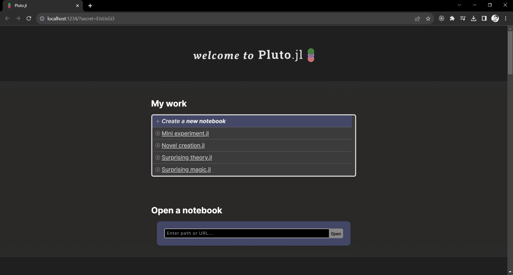
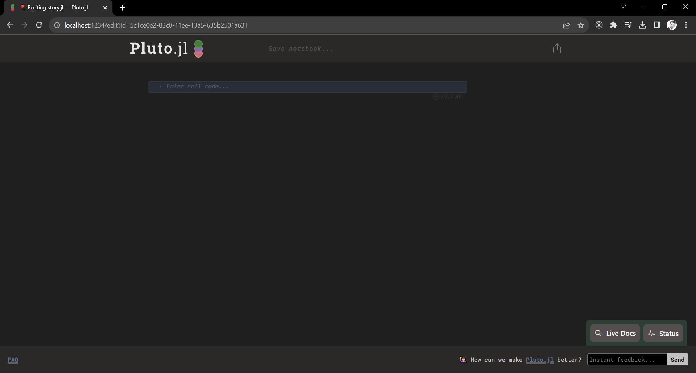
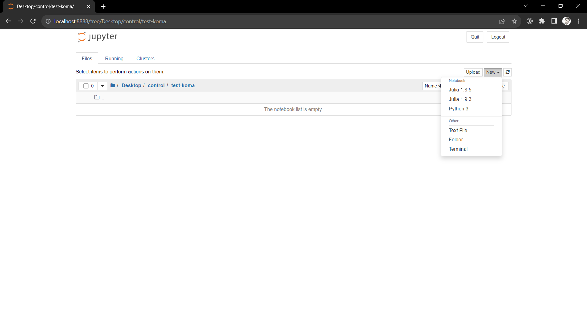
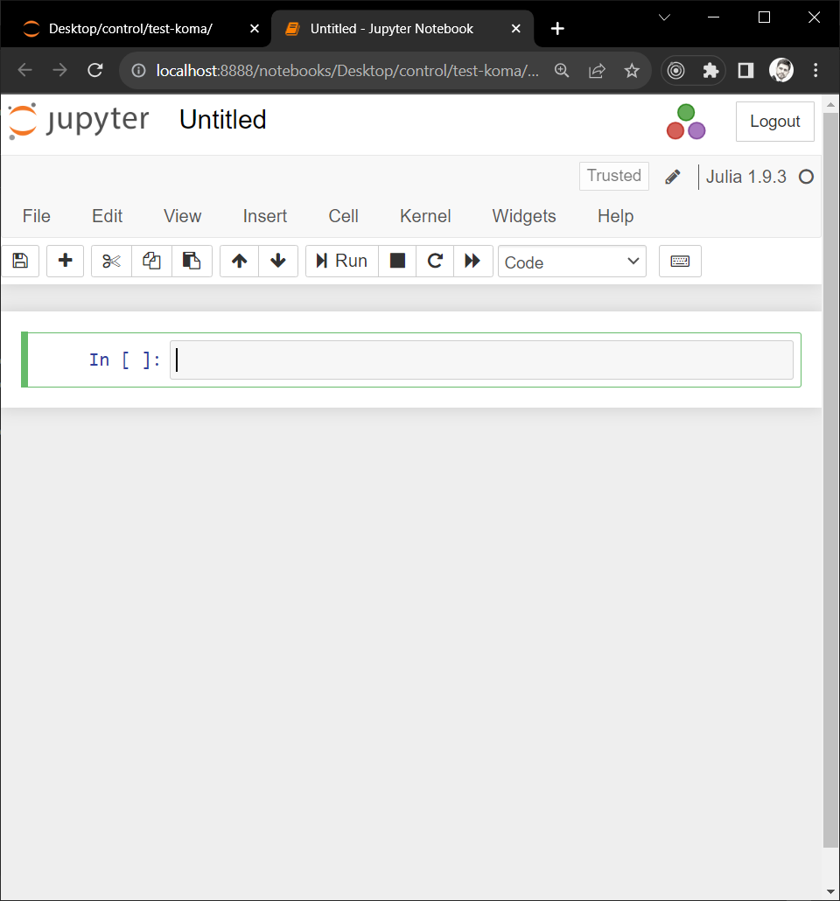

# Use Koma in Notebooks

Run the same brain/EPI example as the [UI](1-1-use-koma-ui.md#Basic-Workflow)
and [Julia script](1-3-use-koma-scripts.md#Basic-Workflow) guides in **Pluto** or **Jupyter**.


## Pluto

First, install the **Pluto** module in your **Julia** environment. Remember to press the `]` button to open the **Package Manager Session**:
```julia-repl
julia> ]

(@v1.13) pkg> add Pluto
```

Afterward, return to the **Julia Session** by pressing the `backspace` button, and then execute the `Pluto.run()` function:
```julia-repl
julia> using Pluto

julia> Pluto.run()
```

This should automatically open the **Pluto** dashboard in your default web browser:

{style="width:75%"}

Next, create a new notebook by clicking on `+ Create a new notebook`:

{style="width:75%"}

Run the [basic workflow](#Basic-Workflow) below, with each code block in its own
cell. Pluto installs the required packages and stores their environment in the notebook.

## Jupyter

Ensure you have **Jupyter** installed on your computer. Follow [this tutorial](https://test-jupyter.readthedocs.io/en/latest/install.html) for installation using **Anaconda**.

Next, install the **IJulia** module in your **Julia** environment. Remember to press the `]` key to open the **Package Manager Session**:
```julia-repl
julia>

(@v1.13) pkg> add IJulia
```

Install the packages used by the workflow:
```julia-repl
(@v1.13) pkg> add KomaMRI MAT
```

Next, open **Jupyter**, navigate to a working folder, and create a new notebook by clicking on `New`, then selecting your installed Julia kernel (e.g. `Julia 1.13.1`).

{style="width:75%"}

A new, empty notebook will appear:

{style="width:75%"}

Run the [basic workflow](#Basic-Workflow) below, with each code block in its own
cell. Plotly figures use the notebook's standard HTML display; no WebIO extension is needed.

## Basic Workflow

### Loading Simulation Inputs

Use the default scanner, brain phantom, and EPI sequence. Zero off-resonance to
match the UI's default phantom:

```julia
using KomaMRI, MAT
```

```julia
sys = Scanner()
```

```julia
begin
    obj = brain_phantom2D()
    obj.Δw .= 0
end
```

```julia
seq = PulseDesigner.EPI_example(; sys)
```

Display the phantom, sequence, and trajectory in separate cells:

```julia
plot_phantom_map(obj, :ρ)
```

```julia
plot_seq(seq)
```

```julia
plot_kspace(seq)
```

### Running Simulation

```julia
sim_params = KomaMRICore.default_sim_params()
```

```julia
raw = simulate(obj, seq, sys; sim_params)
```

```julia
plot_signal(raw)
```

### Reconstructing Image using MRIReco

```julia
rec_params = Dict{Symbol,Any}(:reco => "direct")
```

```julia
result = reconstruct_with_labels(raw; rec_params)
```

```julia
begin
    Nx, Ny = raw.params["reconSize"][1:2]
    image = reshape(first(result.images).image, Nx, Ny)
    plot_image(image * (Nx * Ny))
end
```

### Exporting Results

```julia
begin
    save(ISMRMRDFile(joinpath(tempdir(), "data_raw.mrd")), raw)
    MAT.matwrite(joinpath(tempdir(), "data_image.mat"), Dict("image" => image))
end
```

For the same optional sphere and spiral examples, run the code in
[Phantom](1-3-use-koma-scripts.md#Phantom) and
[Sequence](1-3-use-koma-scripts.md#Sequence) in separate cells. These use `sphere`
and `spiral`, leaving the brain/EPI inputs unchanged.
